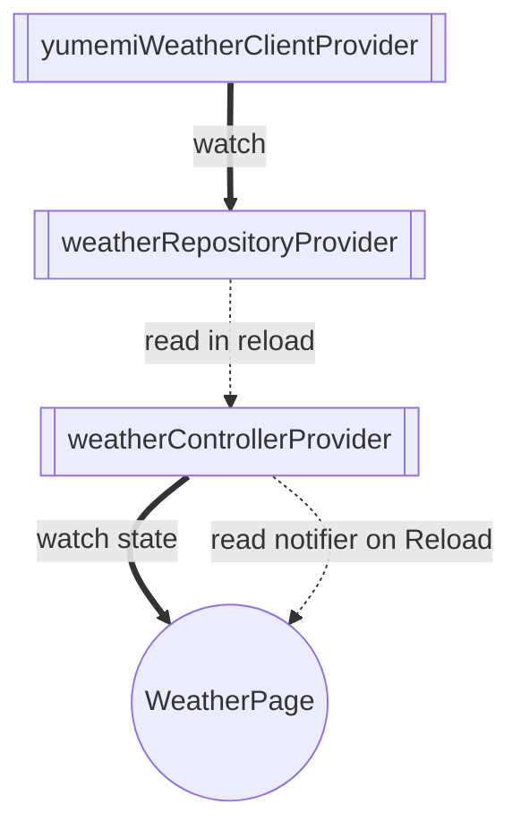

# アーキテクチャ

天気予報画面の状態管理と依存オブジェクトの提供には Riverpod を使用する。
アプリ全体を `ProviderScope` で囲み、画面は Provider を通して天気情報を取得する。

## 各層の責務

| 配置 | 責務 |
| --- | --- |
| `lib/ui/` | 画面の表示、画面遷移、ユーザー操作の受け付け |
| `lib/feature/weather/` | 天気モデル、Repository のインターフェース、例外の定義 |
| `lib/data/repository/` | 天気 API の呼び出し、JSON とモデルの変換、API エラーの変換 |
| `lib/data/weather_provider.dart` | API クライアントと Repository の提供、天気情報の状態管理 |

`WeatherRepository` は取得結果を返し、表示用の状態は保持しない。
`WeatherController` が取得した `Weather?` を状態として保持する。

## Provider と画面の依存関係

矢印は参照される Provider から利用側へ向ける。
太い実線は `ref.watch`、点線は `ref.read` を表す。

- `yumemiWeatherClientProvider` は `YumemiWeather` を生成する。
- `weatherRepositoryProvider` は API クライアントを監視し、`YumemiWeatherApiClient` を `WeatherRepository` として提供する。
- `weatherControllerProvider` は初期状態を `null` とし、`reload()` で Repository を読み、取得結果で状態を更新する。
- `WeatherPage` は天気の状態を監視してアイコンと気温を表示する。Reload 操作では Notifier の `reload()` を呼ぶ。

Provider はすべて `@riverpod` による自動破棄の設定を使用する。
天気画面が破棄されて監視がなくなると天気の状態も破棄され、再表示時は初期状態になる。

